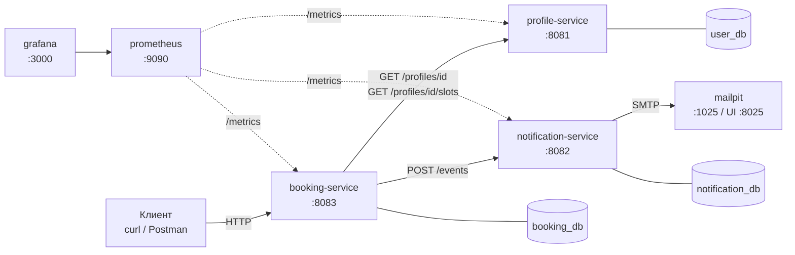

# booking-microservices

Микросервисное приложение для бронирования встреч между пользователями. Практическая работа № 13 — «Разработка микросервисного приложения с использованием сетецентрической архитектуры».

Сервисы работают в отдельных контейнерах, взаимодействуют только по HTTP/REST и не имеют общих данных: у каждого своя база PostgreSQL.

## Состав системы

| Сервис | Роль | Внешний порт | Внутренний адрес | БД |
|---|---|---|---|---|
| `profile-service` | Профили пользователей, недельное расписание, генерация слотов | 8081 | `http://profile-service:8080` | `user_db` |
| `booking-service` | Создание, просмотр и отмена встреч | 8083 | `http://booking-service:8080` | `booking_db` |
| `notification-service` | Приём событий и отправка email-уведомлений | 8082 | `http://notification-service:8080` | `notification_db` |

Инфраструктура:

| Компонент | Назначение | Порт |
|---|---|---|
| `postgres` (17-alpine) | Один сервер, три изолированные БД и три отдельных роли | — |
| `*-migrations` | Одноразовые контейнеры, применяют SQL-миграции каждого сервиса | — |
| `mailpit` | SMTP-заглушка и веб-интерфейс для просмотра писем | 1025 (SMTP), 8025 (UI) |
| `prometheus` | Сбор метрик со всех сервисов и postgres-exporter | 9090 |
| `grafana` | Визуализация метрик | 3000 |
| `postgres-exporter` | Метрики PostgreSQL | 9187 |

Соответствие терминам задания: `profile-service` = User Service, `booking-service` = Order Service, `notification-service` = Notification Service.

## Архитектура



### Сценарий создания встречи (`POST /bookings`)

1. `booking-service` валидирует запрос.
2. Запрашивает у `profile-service` организатора и приглашённого (`GET /profiles/{id}`).
3. Проверяет, что запрошенный интервал совпадает со слотом обоих участников (`GET /profiles/{id}/slots?date=...`).
4. Сохраняет встречу в `booking_db`. Пересечение встреч одного пользователя запрещено ограничением БД (`EXCLUDE USING gist`).
5. Отправляет событие `booking.created` в `notification-service` (`POST /events`), тот пишет уведомления в свою БД и отправляет письма через SMTP.

Отмена (`DELETE /bookings/{id}`) работает аналогично и отправляет событие `booking.cancelled`.

### Поведение при отказе зависимостей

- `profile-service` недоступен: создание встречи возвращает `503 dependent service unavailable`.
- `notification-service` недоступен: встреча всё равно создаётся, ошибка пишется в лог (best effort), клиент получает успешный ответ.
- Таймауты HTTP-клиентов: 5 с для `profile-service`, 10 с для `notification-service`.

### Реализованные принципы

- Взаимодействие компонентов только по сети, обращение по именам сервисов Docker-сети `backend`.
- Database per service: у каждого сервиса своя БД и своя роль, обращения к чужим данным только через API.
- Loose coupling: связь по контракту HTTP/JSON, адреса зависимостей задаются переменными `USER_SERVICE_URL`, `NOTIFICATION_SERVICE_URL`.
- Stateless: состояние хранится только в БД.
- Устойчивость и наблюдаемость: таймауты, graceful shutdown, health-проверки, метрики Prometheus, идемпотентность событий уведомлений (`UNIQUE (event_id, recipient_id)`).

## Технологии и зависимости

- Язык: Go (`go 1.27.4` в `go.mod`), только стандартная библиотека `net/http` (роутинг `mux.HandleFunc("METHOD /path")`).
- Библиотеки (одинаковые во всех сервисах):
  - `github.com/jackc/pgx/v5` — драйвер PostgreSQL
  - `github.com/google/uuid` — идентификаторы
  - `github.com/prometheus/client_golang` — метрики
- Docker: многоэтапная сборка (`golang:1.27-alpine` → `gcr.io/distroless/static-debian12:nonroot`), статический бинарь.
- В `docker-compose.yaml` сервисы запускаются с `read_only: true`, `cap_drop: ALL`, `no-new-privileges`.
- Образы: `postgres:17-alpine`, `axllent/mailpit`, `prom/prometheus`, `grafana/grafana`, `prometheuscommunity/postgres-exporter`.

## Структура репозитория

```
booking-microservices/
├── booking-service/            # сервис встреч
│   ├── cmd/main.go             # точка входа, роутинг, graceful shutdown
│   ├── internal/
│   │   ├── booking/            # model, handler, service, repository, errors
│   │   ├── clients/            # HTTP-клиенты profile-service и notification-service
│   │   ├── config/             # чтение переменных окружения
│   │   ├── health/             # /health/live, /health/ready
│   │   ├── metrics/            # middleware Prometheus
│   │   └── storage/            # подключение к PostgreSQL
│   ├── migrations/001_create_bookings.sql
│   ├── Dockerfile
│   └── go.mod, go.sum
├── profile-service/            # сервис профилей
│   ├── cmd/main.go
│   ├── internal/
│   │   ├── user/               # профили (CRUD)
│   │   ├── schedule/           # расписание и слоты
│   │   ├── config/ health/ metrics/ storage/
│   ├── migrations/001_create_users.sql
│   ├── Dockerfile
│   └── go.mod, go.sum
├── notification-service/       # сервис уведомлений
│   ├── cmd/main.go
│   ├── internal/
│   │   ├── notification/       # события, уведомления, статусы
│   │   ├── mail/               # SMTP-отправитель
│   │   ├── config/ health/ metrics/ storage/
│   ├── migrations/001_create_notifications.sql
│   ├── Dockerfile
│   └── go.mod, go.sum
├── postgres/init/01-create-databases.sh   # создание БД и ролей
├── prometheus/prometheus.yml              # конфигурация сбора метрик
├── docs/API.md                            # описание API
├── docker-compose.yaml
├── Makefile
├── .env.example
└── README.md
```

## Модель данных

| БД | Таблицы |
|---|---|
| `user_db` | `users` (уникальный email без учёта регистра), `availability_rules` (недельные интервалы доступности) |
| `booking_db` | `bookings`, `booking_participants` (роли `organizer` / `invitee`, запрет пересечений по пользователю) |
| `notification_db` | `notifications` (статусы `pending` / `sent` / `failed`, канал `email`) |

Миграции применяются автоматически контейнерами `user-migrations`, `booking-migrations`, `notification-migrations`.

## Запуск

Требуется Docker с Compose v2.

```bash
cp .env.example .env
docker compose up --build -d
```

Либо через Makefile:

```bash
make up-build
```

Остановка: `make down` (с удалением томов: `make clean-volumes`).

### Адреса после запуска

| Что | URL |
|---|---|
| profile-service | http://localhost:8081 |
| notification-service | http://localhost:8082 |
| booking-service | http://localhost:8083 |
| Mailpit (письма) | http://localhost:8025 |
| Prometheus | http://localhost:9090 |
| Grafana | http://localhost:3000 |

### Основные команды Makefile

| Команда | Действие |
|---|---|
| `make up` / `make up-build` / `make down` | Запуск, сборка и запуск, остановка |
| `make ps` / `make logs` | Статус контейнеров, логи |
| `make logs-service SERVICE=booking-service` | Логи одного сервиса |
| `make migrate` | Применить миграции вручную |
| `make db-shell` | psql в контейнере PostgreSQL |
| `make health` | Проверка `/health/ready` всех сервисов |
| `make test`, `make vet`, `make fmt`, `make tidy` | Инструменты Go |

## Конфигурация

Основные переменные окружения (значения по умолчанию заданы в `docker-compose.yaml`, примеры в `.env.example`):

| Переменная | Сервис | Описание |
|---|---|---|
| `HTTP_PORT` | все | Порт внутри контейнера (8080) |
| `DATABASE_URL` | все | Строка подключения к своей БД |
| `USER_SLOT_DURATION` → `SLOT_DURATION` | profile | Длительность слота (по умолчанию `60m`) |
| `USER_SERVICE_URL` | booking | Адрес profile-service |
| `NOTIFICATION_SERVICE_URL` | booking | Адрес notification-service |
| `SMTP_HOST`, `SMTP_PORT`, `SMTP_USERNAME`, `SMTP_PASSWORD`, `SMTP_FROM` | notification | Параметры SMTP (по умолчанию Mailpit) |
| `*_HTTP_READ_TIMEOUT`, `*_HTTP_WRITE_TIMEOUT`, `*_HTTP_IDLE_TIMEOUT` | все | Таймауты HTTP-сервера |
| `*_EXTERNAL_PORT` | все | Порты, опубликованные на хосте |

## Наблюдаемость

- `GET /health/live` и `GET /health/ready` (проверка БД) у каждого сервиса.
- `GET /metrics` у каждого сервиса: `http_requests_total{method,path,status}` и `http_request_duration_seconds{method,path}`.
- Prometheus опрашивает сервисы каждые 5 секунд (`prometheus/prometheus.yml`).

## Документация API

Подробное описание эндпоинтов: [docs/API.md](docs/API.md).
